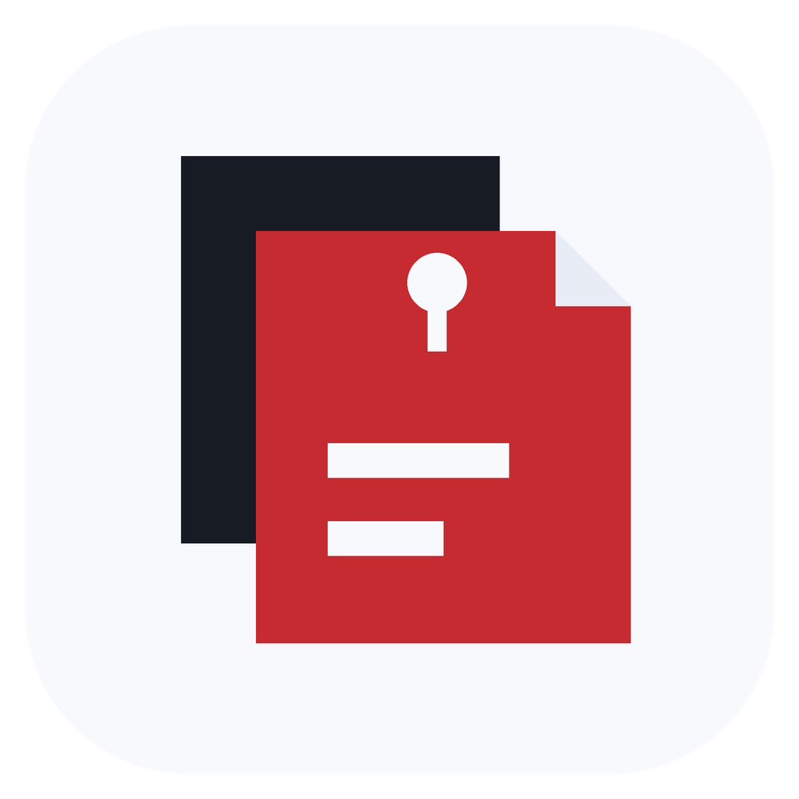
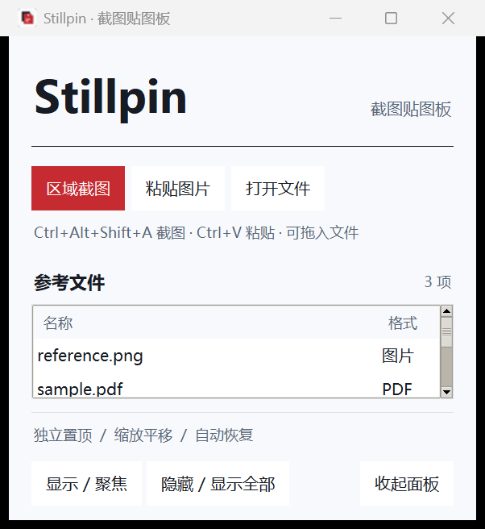
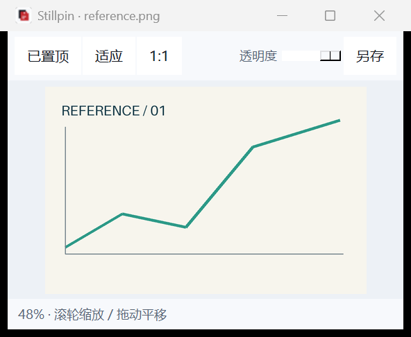

# Stillpin

**让参考固定在眼前。** A portable reference pinboard for Windows.

截图、粘贴参考图，或打开 PDF 和文本，以独立置顶窗口悬浮在代码编辑器、绘图软件和 PowerPoint 上方。冷白底、黑灰排版、少量朱红强调。

[下载 Windows 便携版](https://github.com/alyahromagnoli-create/Stillpin/releases/latest) · [使用说明](docs/USER_GUIDE.md)

## 下载运行

在 Release 中下载 **Stillpin_Windows_x64_v1.0.0.zip**，完整解压，然后双击 `Stillpin.exe`。无需安装 Python。

请保留整个文件夹及 `_internal`。运行目录需要可写权限；首次使用后会生成 `data`，保存导入素材副本和会话。移动到其他位置时一起带走即可。

## 功能

- 区域截图，框选完成即生成贴图；Esc 取消。
- Ctrl+V 粘贴截图或文件，支持从资源管理器拖文件到主面板。
- 多个独立参考窗口：置顶、透明度、滚轮缩放、拖动平移。
- PDF 逐页预览，纯文本与代码可滚动查看、选择复制。
- 导入时保留本地副本，不修改原文件；自动恢复上次参考窗口、位置和 PDF 页码。
- 当前图片或 PDF 页面可以另存为 PNG。

| 管理面板 | 独立贴图窗 |
| --- | --- |
|  |  |

截图中使用的是合成参考图和演示文本。

## 快捷键

| 操作 | 按键 |
| --- | --- |
| 全局区域截图 | 优先 Ctrl+Alt+A；冲突时自动尝试备用组合，以面板显示为准 |
| 粘贴图片或文件 | 在主面板或贴图窗按 Ctrl+V |
| 缩放 / 平移 | 滚轮 / 拖动图片 |
| 适应窗口 | 双击图片 |
| PDF 翻页 | 左右箭头 |
| 找回管理面板 | 在贴图窗按 Esc |
| 另存当前预览 | Ctrl+S |

## 支持范围

图片：PNG、JPEG、BMP、WebP、GIF、TIFF、ICO。GIF 仅首帧。PDF 支持翻页，暂不支持加密 PDF。文本支持 TXT、Markdown、常见代码、CSV、JSON 等，单个文本最大 4 MB。

Word、PPT 请打开后截图贴入；程序不直接渲染 Office 文件。PDF 页面为受分辨率上限约束的预览。部分受保护的窗口不允许系统截图。

## 从源码运行

Windows x64，Python 3.12，需包含 Tcl/Tk。

```powershell
python -m venv .venv
.\.venv\Scripts\python.exe -m pip install --cache-dir work\pip-cache -r requirements.txt
.\.venv\Scripts\python.exe src\app.py
```

```powershell
.\.venv\Scripts\python.exe -m pytest tests -q
.\.venv\Scripts\python.exe build.py
```

`build.py` 将打包缓存和临时文件定位在本项目的 `work` 中，生成目录式便携包 `dist/Stillpin`，不使用单文件自解压模式。

## 隐私与验证

参考内容在本机处理，应用不上传截图或文件；不需要账号。`data/assets` 存放副本，移除窗口不会自动删除历史素材。

发布前完成 6 项单元测试、7 组本地 GUI 检查，以及中文空格目录中的独立 EXE 启动、会话恢复和 Win32 置顶检查。仅在一台 Windows 11 x64 电脑验证；尚未在第二台实体电脑或混合 DPI 多显示器环境实测。

## 许可

本项目按 **GNU AGPL v3.0** 发布，见 [LICENSE](LICENSE)。PDF 预览依赖 PyMuPDF，其采用 [AGPL / 商业双许可](https://pymupdf.io/licensing)。第三方组件的许可和来源见 [THIRD_PARTY.md](THIRD_PARTY.md)。
